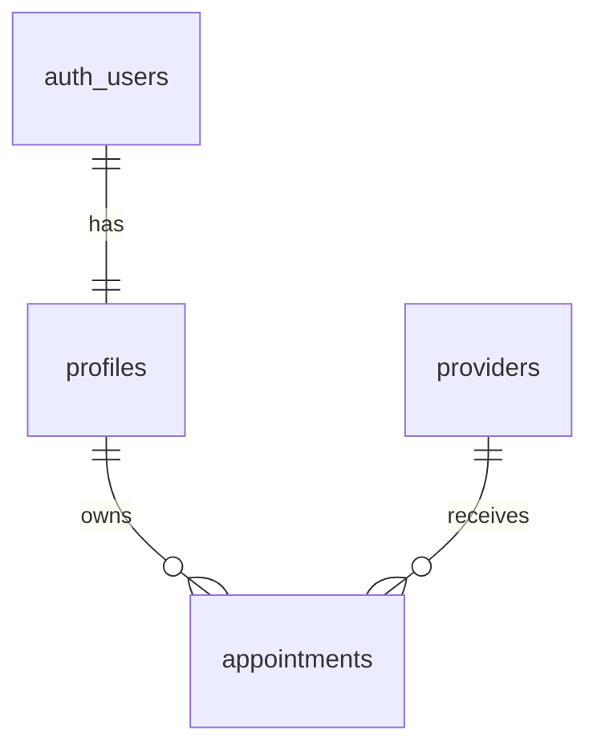
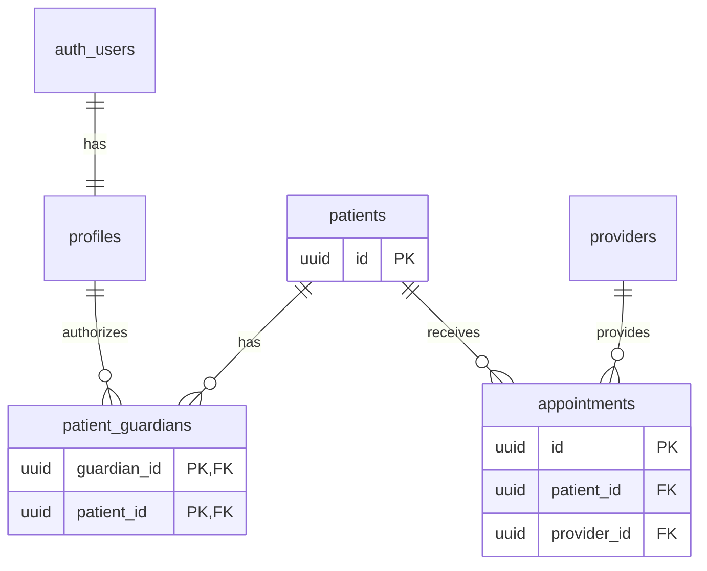

# VisitHarbor

VisitHarbor lets authenticated users book, view, edit, cancel, and delete their own appointments.

**Live demo:** [patient-appointment-manager.vercel.app](https://patient-appointment-manager.vercel.app)

**Enter synthetic data only**, including names and appointment reasons. This is an assessment demonstration, not a system approved for real patient data. Shared demo credentials are delivered privately.

The simplified **1:1 scope** means each account manages its own appointments. There is no separate patient entity, guardian access, or provider login.

## Stack

- Next.js 16 (App Router), React 19, TypeScript
- Tailwind CSS 4
- Supabase Postgres and Auth, with cookie-based sessions via `@supabase/ssr`

## Local setup

Prerequisites: Node.js 26, npm, and Docker running for local Supabase. The Supabase CLI is included as a dev dependency.

```bash
npm ci
npx supabase start
cp .env.example .env.local
npx supabase status
```

Fill in `.env.local` using the local values from `status`:

| Variable | Value |
| --- | --- |
| `NEXT_PUBLIC_SUPABASE_URL` | Local Project URL, normally `http://127.0.0.1:54321` |
| `NEXT_PUBLIC_SUPABASE_PUBLISHABLE_KEY` | Local publishable key (`sb_publishable_...`) |

The application needs no secret/service-role key. Leave the optional `HIBP_RANGE_URL` unset to use the official password-breach service; application signup requires that service to be reachable.

```bash
npm run dev
```

Open [localhost:3000](http://localhost:3000) and create an account. Local Studio is at [127.0.0.1:54323](http://127.0.0.1:54323). Migrations and the five synthetic providers are loaded when the local stack is initialized; demo accounts and appointments are not seeded automatically.

After pulling schema changes, `npx supabase db reset` rebuilds the local database from [migrations](supabase/migrations/) and [provider seeds](supabase/seed.sql). **It deletes all existing local data, including Auth users.** Use `npx supabase stop` to stop the stack.

## Architecture and API

Auth forms use Server Actions. The session proxy handles refresh and redirects; protected data access verifies authentication independently. Appointment logic lives in the server-only [appointment service](lib/appointments/service.ts): Server Components read through it directly, while Client Components mutate through thin Route Handlers. There are no appointment GET endpoints.

| Route | Purpose |
| --- | --- |
| `POST /api/appointments` | Book |
| `PATCH /api/appointments/[id]` | Edit, reschedule, or cancel |
| `DELETE /api/appointments/[id]` | Soft-delete |

The mutation API uses session cookies and requires a matching `Origin`; POST/PATCH require JSON. Strict Zod schemas reject unknown fields, including client-supplied ownership. Starts include a timezone offset, and the server calculates the end. Handler responses use `Cache-Control: private, no-store`; errors have the shape `{ error: { code, message, fieldErrors?, formErrors? } }`, without raw database messages. Foreign, deleted, and missing appointment IDs receive the same 404.

The decisions and alternatives are recorded in:

- [ADR 0001: Password breach screening](docs/adr/0001-screen-sign-up-passwords-against-known-breaches.md)
- [ADR 0002: Soft deletion through a privileged function](docs/adr/0002-soft-delete-appointments-through-a-security-definer-function.md)
- [ADR 0003: Shared service for mutations and server reads](docs/adr/0003-share-appointment-logic-between-route-handlers-and-server-components.md)

## Schema and ownership



`auth_users` represents Supabase's `auth.users`.

- **Profiles:** one per Auth user, created by a signup trigger. Display names are a signup snapshot, never an authorization source.
- **Providers:** a seeded directory of names and specialties.
- **Appointments:** reference the owner's profile through `patient_id` and a provider through `provider_id`, with start/end times, reason, status, and timestamps.

All three public application tables enable RLS. Migrations revoke default API-role grants and grant only the required access:

- Authenticated users read only their own profile and non-deleted appointments; all authenticated users may read the provider directory.
- Appointment INSERT/UPDATE policies enforce ownership, including `WITH CHECK`. Column grants prevent callers from setting or changing ownership, IDs, and managed timestamps.
- Anonymous users and `service_role` receive no application-table grants. The app queries with the user's session and publishable key.
- No API role can hard-delete appointments. The authenticated-only `delete_appointment` function checks ownership explicitly and sets `deleted_at`; RLS then hides the row from ordinary reads and updates.

## Appointment behavior and limits

The database enforces 30-minute visits, quarter-hour starts, future booking/rescheduling, and no overlapping scheduled, non-deleted appointments **for the same patient**. Back-to-back visits are allowed. Business edits and cancellation stop at the original start time; cancelled appointments cannot be edited or reinstated.

The interface groups appointments into Upcoming, Past, and Cancelled tabs and preserves the selected tab in the URL. Times use `America/New_York` (Eastern Time). A scheduled appointment becomes Past at its end; in-progress appointments remain in Upcoming.

- **Booking hours and availability:** the form offers starts from 8:15 a.m. through 4:30 p.m. Eastern Time. This is a UI-only demo window, not an API/database rule or provider availability. Different patients can book the same provider at the same time. A real scheduler would need provider availability and provider-wide conflict checks.
- **Cancellation and deletion:** cancellation is final; rebooking creates a new row. The UI requires cancellation before offering deletion of a future scheduled visit. The backend permits direct soft deletion of any owned live row, including started or cancelled visits. Both cancellation and deletion release the patient's slot.
- **Retention:** soft deletion is not an audit history or erasure; deleted rows remain stored without a purge policy. Deleting an Auth user cascades to hard-delete their appointments. Account deletion is not an app feature and would need a retention decision first.
- **History size:** there is no pagination. The ascending appointment query is subject to the configured 1,000-row cap, so larger histories omit newer appointments.

## Proposed guardian extension (not implemented)

Separate the person receiving care from the account signing in. A child would have a patient record without needing an Auth account; one guardian could manage several patients, and several guardians could manage the same patient.



- **Profiles** would continue to represent authenticated accounts. **Patients** would hold the care recipient's identity independently of those accounts.
- **Patient guardians** would link `guardian_id` to `profiles.id` and `patient_id` to `patients.id`. The pair would form a composite primary key, allowing multiple guardians and children without duplicate relationships.
- **Appointments** would reference `patients.id` instead of `profiles.id`. The existing per-patient overlap constraint would still prevent two guardians from booking overlapping visits for the same child.

For migration, backfill one patient per existing profile using the same ID, and an access relationship for that account's own patient record. Repoint the appointment foreign key while preserving existing appointments and access. Remove the `auth.uid()` default for `patient_id`: booking would require an explicitly selected patient, validated by the server and RLS. Patient records and appointment retention would be independent of a guardian account's deletion.

Enable RLS and minimal grants on both new tables. Patient and appointment reads would require a relationship whose `guardian_id` matches `auth.uid()`. Appointment UPDATE policies would check access to the existing row with `USING`, and INSERT/UPDATE policies would check the target patient with `WITH CHECK`; the soft-delete function would enforce the same relationship rule. Users could read their own relationship rows but could not create or modify them directly. Granting or revoking guardian access would require a trusted administrative process, so knowing a patient ID could never establish access.

## Authentication trade-offs

Application signup accepts passwords of at least 15 Unicode characters and at most 72 UTF-8 bytes, with no character-composition rules. Passwords are NFC-normalized on signup and login. The breach check sends only a five-character SHA-1 prefix to Have I Been Pwned; a match rejects signup, and an unavailable check blocks signup until it can be retried.

Email confirmation is disabled for the demo, so email ownership is unverified. There is no password-reset flow.

Direct Supabase signup can bypass the application's breach check and may expose account existence despite generic UI errors; breach screening at the Auth boundary remains future work. Auth calls from Server Actions can share server-IP rate-limit buckets. Sign-out is local to the session, and an issued access token remains valid until expiry.

## Tests and useful commands

Integration and browser tests reject missing, malformed, or non-loopback Supabase URLs before making requests. Test helpers create synthetic users without cleanup; repeated runs accumulate fixtures until a local database reset. Keep migrations and provider seeds current.

| Command | Purpose |
| --- | --- |
| `npm run lint` / `npm run typecheck` | ESLint / route-type generation and TypeScript checks |
| `npm run build` / `npm start` | Build / serve the production app |
| `npm test` | Vitest unit and local Supabase integration suites |
| `npm run test:watch` | Vitest watch mode |
| `npx supabase test db` | pgTAP database tests |
| `npx playwright install chromium` | Install the browser required for E2E tests |
| `npm run test:e2e` | Playwright; starts the built app and local HIBP stub |
| `npm run db:types` | Regenerate committed public-schema types from local Supabase |

Implemented coverage:

- **Vitest unit:** password/breach checks, redirects, appointment validation, form/error handling, phases, and Eastern Time/DST conversion.
- **Vitest integration:** local Supabase Auth, profile/provider access, cross-user RLS isolation, protected columns, scheduling, timestamps, and soft deletion. Service/handler tests use the real database with only the server-client factory mocked.
- **pgTAP:** grants, RLS, privileged-function boundaries, and in-progress scheduling/timestamp behavior in a rolled-back transaction.
- **Playwright:** authentication, UI CRUD, cross-user isolation, keyboard navigation, validation, and draft retention after session loss. Separate API tests cover cookies, Origin rejection, and cache headers.

Selected CRUD and accessibility tests run at 320px, with axe WCAG A/AA checks through 2.2 and horizontal reflow assertions. Accessibility coverage is limited to tested pages/states. Past/in-progress states have unit/database coverage, not browser coverage.

Integration booking fixtures use fixed January 2031 slots; E2E fixtures use January 2032. They must remain future dates relative to the database clock and will need replacement. Routine tests stub HIBP; the optional live check is:

```bash
HIBP_LIVE=1 npx vitest run --project integration tests/integration/hibp-live.test.ts
```

[CI](.github/workflows/ci.yml) runs lint, typecheck, pgTAP, Vitest, build, and Playwright.

## Deployment and demo data

Run **Deploy production** manually in GitHub Actions with `main` selected. The [workflow](.github/workflows/deploy-production.yml) runs CI, builds using Vercel production settings, applies hosted Supabase migrations and provider seeds, then deploys that build. Its summary records the deployment URL and commit SHA. Git deployments are disabled in `vercel.json`; dashboard redeploys bypass the database steps.

Required configuration:

| Location | Names |
| --- | --- |
| GitHub `production` environment secrets | `SUPABASE_ACCESS_TOKEN`, `SUPABASE_DB_PASSWORD`, `VERCEL_TOKEN` |
| GitHub `production` environment variables | `SUPABASE_PROJECT_ID`, `VERCEL_ORG_ID`, `VERCEL_PROJECT_ID` |
| Vercel production environment | `NEXT_PUBLIC_SUPABASE_URL`, `NEXT_PUBLIC_SUPABASE_PUBLISHABLE_KEY` for hosted Supabase, both saved as **Config** |

Hosted Auth settings require separate configuration; the workflow applies migrations and seeds, not `supabase/config.toml`. Database changes are not automatically rolled back if deployment fails, so migrations must remain compatible with the running app.

For appointment history, create two demo accounts through the app, then run the entire [demo-data script](scripts/demo-appointments.sql) as `postgres` in the intended project's Supabase SQL Editor after replacing its two profile-ID placeholders privately. It creates two past, two upcoming, and one cancelled synthetic appointment per account. Reruns restore those demo rows, including deleted ones, without changing unrelated appointments. The transaction temporarily disables the scheduling trigger to create past visits; other constraints remain active.

## Before production

If taking this demonstration toward production, I would focus next on these items. They are priorities, not a complete production-readiness checklist:

- **Scheduling:** provider availability and provider-wide conflict prevention, with booking restrictions enforced server-side.
- **Account security and recovery:** email verification, password reset/update, and breach screening enforced at the Auth boundary.
- **Complete appointment histories:** pagination so larger histories are not silently truncated.
- **Data lifecycle:** defined retention and deletion policies before accepting real patient data.
- **Audit logging:** a durable, access-controlled record of who changed appointments or access permissions, what operation occurred, and when, without copying appointment reasons or other unnecessary sensitive data into logs.
