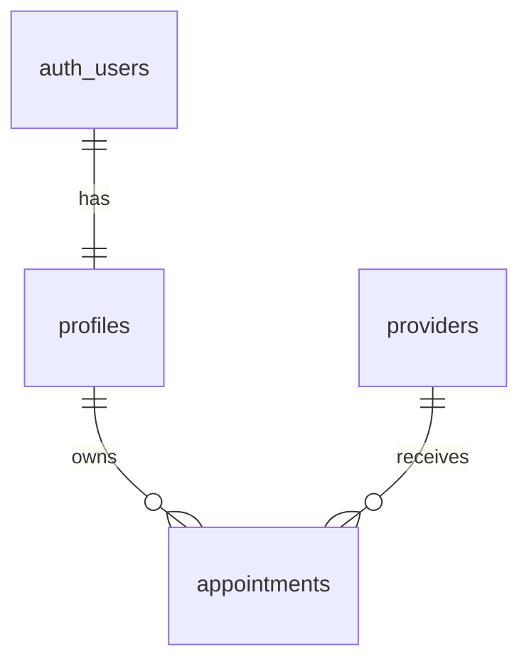

# Patient Appointment Manager

VisitHarbor is a patient appointment manager: a web application for patients to schedule, view, and manage their own appointments. Each authenticated user manages only their own appointments.

## Stack

- [Next.js](https://nextjs.org) 16 (App Router), React 19, TypeScript
- Tailwind CSS 4
- [Supabase](https://supabase.com) for Postgres and authentication, via `@supabase/ssr` with cookie-based sessions

## Getting started

Prerequisites: Node.js 26, npm, and Docker (for the local Supabase stack).

```bash
npm ci
npx playwright install chromium   # browser for end-to-end tests
npx supabase start                # first run downloads the Docker images
cp .env.example .env.local        # then paste the publishable key (see below)
npm run dev
```

The app runs at [localhost:3000](http://localhost:3000). Installing dependencies also sets up the Git hooks via Husky.

## Local Supabase

The Supabase CLI is a dev dependency, so run it through `npx`. Its configuration lives in `supabase/config.toml`, and migrations go in `supabase/migrations/`.

| Command | Purpose |
| --- | --- |
| `npx supabase start` / `npx supabase stop` | Start or stop the local stack |
| `npx supabase status` | Show local URLs and keys |
| `npx supabase db reset` | Recreate the local database, apply migrations, and load provider seeds |
| `npx supabase migration new <name>` | Create a new migration file |

`npx supabase status` prints the values for `.env.local`:

| Variable | Value from `status` |
| --- | --- |
| `NEXT_PUBLIC_SUPABASE_URL` | Project URL (`http://127.0.0.1:54321`) |
| `NEXT_PUBLIC_SUPABASE_PUBLISHABLE_KEY` | Publishable key (`sb_publishable_...`) |

Studio runs at [127.0.0.1:54323](http://127.0.0.1:54323).

`npx supabase db reset` deletes existing local data, including Auth users, then applies `supabase/migrations/` and loads the five synthetic providers from `supabase/seed.sql`.

Supabase clients live in `lib/supabase/`: `client.ts` for Client Components and `server.ts` for server code.

## Commands

| Command | Purpose |
| --- | --- |
| `npm run dev` | Start the development server |
| `npm run build` / `npm start` | Build and serve the production app |
| `npm run lint` | Run ESLint |
| `npm run typecheck` | Generate route types and check TypeScript |
| `npm run db:types` | Regenerate committed TypeScript types from the local public schema |
| `npx supabase test db` | Run pgTAP database privilege, RLS, and appointment time-lock checks |
| `npm test` | Run unit and integration tests |
| `npm run test:watch` | Run unit and integration tests in watch mode |
| `npm run test:e2e` | Run end-to-end browser tests |

## Testing

Start the local Supabase stack before running tests, with migrations applied and provider seeds loaded. The pre-push hook runs lint, build, and `npm test`; it does not run pgTAP or Playwright. CI runs both separately.

- **Unit** (Vitest): password rules, the breached-password check, redirect rules, appointment input validation, and the database-to-API error mapping.
- **Integration** (Vitest, local Supabase): Auth settings, profile creation, provider reads and write denial, appointment ownership isolation, protected columns, duration and overlap constraints, scheduling rules, timestamps, and soft deletion. Clients use the publishable key and separate user sessions. The appointment service and Route Handlers run against the same database, with only the server client factory mocked.
- **Database** (pgTAP): table and column privileges, effective defaults on new objects, RLS configuration, policy metadata, trigger wiring, and function permissions/settings. A privileged fixture creates an in-progress appointment inside a rolled-back transaction; behavior is then tested as its authenticated owner.
- **End-to-end** (Playwright, Chromium): auth flows in a browser, against a local Have I Been Pwned stub, and the appointment API from a signed-in browser: cookie sessions, refused cross-site requests, and uncached responses.

The check against the real Have I Been Pwned API is manual. Run it after changing the checker:

```bash
HIBP_LIVE=1 npx vitest run --project integration tests/integration/hibp-live.test.ts
```

## Database

The assessment uses the CIO-approved 1:1 scope: one account manages its own patient appointments. There is no separate patient entity or guardian access.



`auth_users` in the diagram represents Supabase's `auth.users` table.

- **profiles:** one row per Auth user, with structured names copied at signup. The signup trigger trims names and converts empty values to NULL. Names are a snapshot and don't follow later Auth metadata edits.
- **providers:** a synthetic, authenticated-read-only directory of names and specialties, populated by the seed file. Providers are directory entries, without login accounts.
- **appointments:** links a profile (`patient_id`) and provider with start/end times, reason, status, and creation/update/deletion timestamps. `provider_id` is deliberately unindexed until provider-based queries or deletion need it.

### Grants and policies

These are the application objects' API-role privileges. Each table has RLS enabled, with one policy per permitted operation and WITH CHECK on writes.

| Object | anon | authenticated | service_role | Row access |
| --- | --- | --- | --- | --- |
| profiles | None | SELECT | None | Own profile only |
| providers | None | SELECT | None | All directory rows |
| appointments | None | SELECT; column-scoped INSERT and UPDATE | None | Own non-deleted rows; inserted/updated rows must remain caller-owned |
| delete_appointment(uuid) | None | EXECUTE | None | Function checks ownership and requires a live row |
| private schema and its trigger functions | None | None | None | Internal trigger use only |

Appointment INSERT is limited to `provider_id`, `starts_at`, `ends_at`, and `reason`. UPDATE permits those columns plus `status`. Users cannot supply or modify IDs, ownership, creation time, update time, or deletion time. No API role receives DELETE.

The read policies are `Patients can view own profile`, `Patients can view all providers`, and `Patients can view own appointments`. Appointment write policies are `Patients can create appointments` and `Patients can update own appointments`.

### Scheduling and deletion

Appointments last exactly 30 minutes and start on 15-minute boundaries, both enforced by database CHECKs. The alignment check is computed from the absolute time, so it gives the same result in every timezone. A GiST exclusion constraint prevents overlapping scheduled, non-deleted appointments for the same patient. End times are exclusive, so back-to-back appointments are allowed. Cancellation and deletion free the slot. Different patients can book the same time; provider availability is outside the current model.

Database triggers reject bookings or rescheduling at or before the current database time. Business fields cannot be edited once the original appointment has started or is cancelled. Cancellation is final; rebooking creates a new row. The edit cutoff uses the original start time, even if an update tries to move it into the future. Distinct error codes let the API explain which scheduling rule applied. Status is stored as `scheduled` or `cancelled`; the derived `past` state means a scheduled appointment whose end has passed.

Deletion calls `delete_appointment(appointment_id)`, which sets `deleted_at` only for the caller's live row. RLS hides deleted rows from ordinary reads and updates. Started and cancelled appointments can still be soft-deleted.

[ADR 0002](docs/adr/0002-soft-delete-appointments-through-a-security-definer-function.md) explains the SECURITY DEFINER function, alternatives, and privilege boundary.

Regenerate and commit database types with `npm run db:types` after schema changes.

### Extending to guardian access

This is a future migration path, not implemented behavior:

1. Introduce a separate `patients` table so patient identity is independent of the authenticated account.
2. Backfill one patient per existing profile, using the profile ID as the patient ID to preserve existing appointment references.
3. Repoint `appointments.patient_id` to `patients.id`.
4. Add guardian-to-patient relationships and policies that authorize access through those relationships, including WITH CHECK on appointment writes. A supplied patient ID must never establish authorization by itself.

## Authentication

Auth forms submit to Server Actions in `app/(auth)/actions.ts`.

`proxy.ts` refreshes the session and redirects signed-out visitors to `/login`. Every page except `/`, `/login`, and `/signup` requires a session. The proxy check is only optimistic: pages verify the session with `getCurrentUser()` in `lib/auth/dal.ts`.

## API

The API uses cookie authentication and is intended for the same-origin web application. Client Components change appointments through three Route Handlers. Server Components read through the server-only `lib/appointments/` service directly, so there are no read endpoints; [ADR 0003](docs/adr/0003-share-appointment-logic-between-route-handlers-and-server-components.md) explains why. Both paths share the same session check, validation, and error mapping, and RLS still decides which rows a user can reach.

| Route | Purpose |
| --- | --- |
| `POST /api/appointments` | Book an appointment |
| `PATCH /api/appointments/[id]` | Reschedule, edit, or cancel |
| `DELETE /api/appointments/[id]` | Soft-delete |

Request bodies are strict: fields the client may not set, such as `patientId`, are rejected rather than ignored. Starts need an explicit timezone offset and must fall on a quarter hour; the server computes the end. Errors share one shape, `{ error: { code, message, fieldErrors?, formErrors? } }`, so the UI can show each message next to the right field.

## Security

- Passwords follow [NIST SP 800-63B-4](https://pages.nist.gov/800-63-4/sp800-63b.html): at least 15 characters, no composition rules, and rejected if they appear in a known breach. Only a 5-character hash prefix is sent to Have I Been Pwned, and sign-up is refused if the check is unavailable. See [ADR 0001](docs/adr/0001-screen-sign-up-passwords-against-known-breaches.md) for the decision and trade-offs.
- Sign-in and sign-up errors don't reveal whether an account exists.
- Return-to links only accept same-site paths.
- Names are display-only and never used for authorization.
- Migrations revoke the API roles' default table, sequence, and function grants in `public`. A global revoke removes function execution through `PUBLIC`. Each application object then gets explicit minimal grants. `service_role` receives no grants on application objects, despite its RLS bypass capability.
- RLS does not cover TRUNCATE, so its privilege is explicitly excluded alongside other unnecessary administrative permissions. Column checks also reject unexpected grants, including grants on future columns.
- The `private` schema is not exposed by the Data API and has no API-role privileges. Its trigger helpers pin empty search paths. Only signup profile creation and the public delete function use SECURITY DEFINER; scheduling and timestamp helpers use invoker security.
- Cross-user appointment reads return no rows. Updates targeting foreign, deleted, or nonexistent IDs return no rows; the delete RPC returns false for all three. These operations, and the API's 404s, do not distinguish whether another user's row exists.
- The application never uses the secret key; only the URL and publishable key are public.
- Application code does not log appointment reasons or names.
- API mutations require an `Origin` matching the deployment's public scheme, host, and port, and POST and PATCH also require JSON bodies. Route Handlers don't get the Server Actions origin check, and `SameSite=Lax` cookies alone don't stop every cross-site request.
- Mutation responses are `private, no-store` and never include raw database errors.

## Deployment notes

- The hosted Supabase project must match `supabase/config.toml`: minimum password length 15, email confirmations off.
- Provider seeding on the hosted project is manual.
- The delete function relies on its owner bypassing RLS. This is verified locally; verify it on the hosted project too.

## Known limitations

- **Demo authentication:** email confirmation is off, so email ownership isn't verified, and there is no password reset. Auth rate limits apply per server IP, so all users share them. Calling the Supabase Auth API directly skips the breached-password check; Supabase's hosted leaked-password protection would close this. After sign-out, the current access token stays valid until it expires (up to an hour).
- **Scheduling:** provider availability and provider-wide conflicts are not checked, so different patients can book the same provider at the same time.
- **Retention:** soft deletion records when a row was deleted, not a history of changes, and deleted rows stay stored without a purge policy. Deleting an Auth user cascades and hard-deletes their appointments, so account deletion needs a retention decision first.
- **Pagination:** the appointment list isn't paginated and is capped at 1000 rows.
